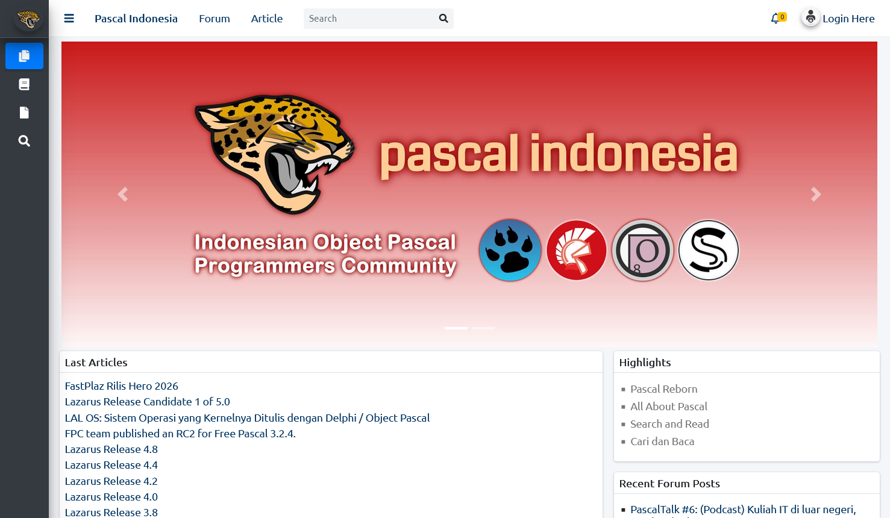

# Pascal Indonesia Web Forum

[](https://www.pascal-dev.org)
[](https://github.com/fastplaz/fastplaz)
[](LICENSE)

[English](README.md) | **Bahasa Indonesia**



Source code [pascal-dev.org](https://www.pascal-dev.org), website
**Komunitas Programmer Object Pascal Indonesia**: forum, artikel/berita, dan pencarian,
serta JSON API. Ditulis dengan Object Pascal menggunakan
[FastPlaz](https://github.com/fastplaz/fastplaz), web framework untuk Free Pascal.

## Daftar Isi

- [Fitur](#fitur)
- [Teknologi](#teknologi)
- [Struktur Proyek](#struktur-proyek)
- [Kebutuhan](#kebutuhan)
- [Memulai](#memulai)
- [Konfigurasi](#konfigurasi)
- [Build](#build)
- [Route Web](#route-web)
- [API](#api)
- [Catatan Deployment](#catatan-deployment)
- [Kontribusi](#kontribusi)
- [Lisensi](#lisensi)

## Fitur

- **Forum**: kategori, daftar topik, thread, dan membuat topik baru.
- **Artikel / Berita**: daftar dan halaman detail artikel (konten Markdown), menulis artikel baru, dan melaporkan artikel yang sudah usang (obsolete).
- **Pencarian** di artikel dan posting forum.
- **Autentikasi**: login/logout, login dengan Facebook, dan login berbasis token.
- **Profil pengguna**.
- **JSON API** untuk forum, berita, topik, statistik, dan autentikasi.
- **SEO**: URL yang ramah (`/news/{id}/{slug}`), meta tag Open Graph, dan `sitemap.xml`.
- Tema responsif berbasis AdminLTE / Bootstrap.

## Teknologi

| Lapisan | Teknologi |
|---|---|
| Bahasa | Object Pascal (Free Pascal 3.2.x) |
| Framework | [FastPlaz](https://github.com/fastplaz/fastplaz) |
| Database | MySQL (5.6 ke atas, sudah dites di 8.0) |
| Web server | Apache 2.4 atau LiteSpeed, aplikasi berjalan sebagai CGI (`.bin`) dengan `mod_rewrite` |
| Front end | AdminLTE, Bootstrap, jQuery, Font Awesome, Summernote, Toastr |

## Struktur Proyek

```
web-forum/
├── docs/                   # dokumentasi & screenshot
│   └── api/                # dokumentasi API (Forum, News, Topics)
├── public_html/            # document root website
│   ├── *.bin               # aplikasi web hasil compile: forumpascal, auth, search
│   ├── api/                # document root API (*.bin, config, .htaccess)
│   ├── config/             # config.json (tidak masuk git), config.json-example
│   ├── modules/            # template, css & js per modul
│   ├── themes/             # PascalIndonesia (tema utama), default
│   ├── files/              # file upload
│   └── ztemp/              # cache, session, error log
└── source/
    ├── common/             # kode bersama: model, controller, common_lib
    ├── web/                # aplikasi web: forumpascal.lpr, auth.lpr, search.lpr
    │   ├── controllers/
    │   └── routes/
    └── api/                # aplikasi API: forum, news, topic, stats, auth
        ├── controllers/
        └── routes/
```

Setiap file `.lpr` adalah program terpisah. Hasil compile-nya berupa `.bin` (CGI)
di `public_html/` (web) atau `public_html/api/` (API).

## Kebutuhan

- [Free Pascal](https://www.freepascal.org/) 3.2.x. [Lazarus](https://www.lazarus-ide.org/) opsional, untuk mengedit (file proyek `.lpi`).
- Source code [FastPlaz](https://github.com/fastplaz/fastplaz).
- MySQL server dan client library-nya (`libmysqlclient` / `libmysql.dll`).
- Apache 2.4 (atau LiteSpeed) dengan CGI dan `mod_rewrite` aktif, serta `AllowOverride All` untuk `public_html`.

## Memulai

1. **Letakkan source bersebelahan dengan FastPlaz.** Opsi compiler (`extra.cfg`) mencari
   FastPlaz di `../../../vendors/fastplaz`, jadi strukturnya:

   ```
   <workspace>/
   ├── vendors/
   │   └── fastplaz/        # git clone https://github.com/fastplaz/fastplaz.git (boleh symlink)
   └── web-forum/           # repository ini
   ```

2. **Buat database** di MySQL. Skema database tidak disertakan di repository ini.

3. **Buat konfigurasi** untuk web dan API:

   ```bash
   cp public_html/config/config.json-example public_html/config/config.json
   # public_html/api/config/config.json untuk API
   ```

   Lalu isi pengaturan database (lihat [Konfigurasi](#konfigurasi)).

4. **Build** aplikasinya (lihat [Build](#build)).

5. **Buat virtual host** dengan document root `public_html/`,
   misalnya `http://pascal-dev.test`. File `.htaccess` yang sudah ada akan meneruskan
   request ke `.bin` yang sesuai.

## Konfigurasi

`public_html/config/config.json` (dan `public_html/api/config/config.json` untuk API).
File ini berisi kredensial dan tidak masuk git.

| Key | Keterangan |
|---|---|
| `systems/baseurl` | URL dasar situs, mis. `http://pascal-dev.test/` |
| `systems/theme` | Nama tema, `PascalIndonesia` |
| `systems/development`, `systems/debug` | Mode development/debug |
| `systems/session_storage` | Tempat penyimpanan session, mis. `database` |
| `database/default/driver` | mis. `MySQL 8.0` |
| `database/default/hostname`, `port`, `username`, `password`, `database_name` | Koneksi database |
| `database/default/charset` | Charset koneksi. Kosongkan untuk memakai default FastPlaz (`utf8mb4` untuk MySQL). |
| `database/default/library` | Path ke MySQL client library, jika tidak ada di path sistem |
| `image/sourceBaseURL` | URL dasar CDN gambar |
| `mailer/default/*` | Pengaturan SMTP |

## Build

Script build meng-compile setiap program dengan `fpc` dan opsi di `extra.cfg`.

```bash
# aplikasi web -> public_html/*.bin
cd source/web
./build.sh forumpascal      # satu program
./build-all.sh              # auth, forumpascal, search

# aplikasi API -> public_html/api/*.bin
cd source/api
./build.sh news
./build-all.sh              # forum, news, stats, topic, auth
```

Di Windows, jalankan script dari Git Bash. `clean.sh` menghapus unit hasil compile.

**Build untuk hosting Linux lama.** Binary yang di-build di distro baru membutuhkan glibc
versi baru dan bisa gagal (HTTP 500) di hosting dengan glibc lama (mis. cPanel/CloudLinux 8).
`build-docker.sh` mem-build di dalam image Docker dengan glibc lama:

```bash
./build-docker.sh forumpascal      # build incremental
./build-docker.sh all              # semua *.lpr
```

Bisa juga membuka `source/WEB.lpg` atau `source/API.lpg` (project group) di Lazarus.

## Route Web

| Path | Keterangan |
|---|---|
| `/` | Halaman utama |
| `/forum` | Indeks forum |
| `/forum/category/{id}/{slug}` | Kategori forum |
| `/forum/{id}/{slug}` | Daftar topik dalam forum |
| `/forum/{id}/{slug}/new/` | Topik baru |
| `/thread/{forum}/{id}/{slug}` | Thread |
| `/news/`, `/article/` | Daftar artikel |
| `/news/{id}/{slug}` | Detail artikel |
| `/news/new/` | Artikel baru |
| `/obsolete/` | Laporkan artikel usang |
| `/profile/{username}` | Profil pengguna |
| `/user` | Halaman pengguna |
| `/auth/...` | Login, logout, login Facebook, token (`auth.bin`) |
| `/search/` | Pencarian (`search.bin`) |

## API

API ada di `public_html/api/`. Semua respons berupa JSON:

```json
{ "code": 0, "count": 1, "data": [ ... ] }
```

| Endpoint | Keterangan |
|---|---|
| `GET /news/` | Daftar berita |
| `GET /news/last/?limit=n` | Berita terbaru |
| `GET /news/{id}/{slug}` | Detail berita |
| `GET /news/search/` | Cari berita |
| `GET /forum/` | Daftar forum |
| `GET /topic/recent/` | Topik terkini |
| `GET /topic/last/` | Topik terakhir |
| `GET /topic/thread/{id}/{slug}/` | Thread |
| `GET /topic/search/` | Cari topik |
| `GET /stats/` | Statistik |
| `/auth/` | Autentikasi |

Dokumentasi lengkap, dengan parameter dan contoh respons, ada di [docs/api](docs/api):
[Forum](docs/api/Forum.md), [News](docs/api/News.md), [Topics](docs/api/Topics.md).

## Catatan Deployment

- Upload file `.bin` hasil compile dan `public_html/` ke server. Jangan upload `config.json` lokal; pakai config milik server.
- File `.htaccess` di `public_html/modules/` memakai `mod_rewrite` agar hanya aset statis
  (css, js, gambar, font) yang bisa diakses. Aturan lama `deny from all` + `<FilesMatch>`
  tidak berjalan di LiteSpeed.
- Di Windows (development), FastPlaz mengatur default code page ke UTF-8 agar teks dari
  database tampil dengan benar. Pastikan build memakai FastPlaz versi terbaru.
- Jika situs berada di belakang Cloudflare, purge cache setelah mengubah css/js.

## Kontribusi

Kontribusi sangat diterima. Lihat [CONTRIBUTING.md](CONTRIBUTING.md):

1. Fork repository ini.
2. Buat branch fitur: `git checkout -b fitur-baru`
3. Commit perubahan: `git commit -am 'Tambah fitur'`
4. Push branch: `git push origin fitur-baru`
5. Buat Pull Request.

Laporan bug dan permintaan fitur: gunakan issue template di repository ini.

## Lisensi

[MIT](LICENSE) © 2019 Pascal Indonesia
